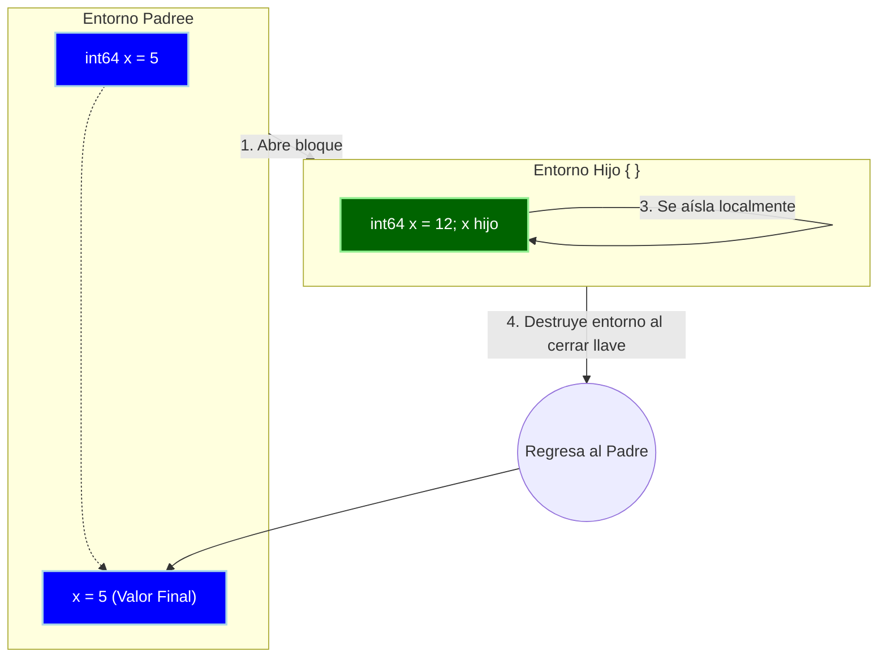

En este archivo vamos a enumerar los objetivos para la entrega final, ademas aprovecharemos para documentar algunas decisiones que se tomaron y no se documentaron plenamente

# Que hay ahora 

Asumiendo que no hay bugs (que seguramente los hay) podemos valernos de los tests para saber que tenemos.

Los principales tests están en el archivo [wyrm.rs](../src/wyrm.rs), ya que es una prueba que simula una ejecución "E2E" 

## Test 1 y retornos

```rs
#[test]
    fn test_wyrm_respeta_punt_y_coma() {
        let input = format!("2+3; 3+6");
        let wyrm = Wyrm::new(false);

        unsafe {
            let resultado = wyrm.call_wyrm(&input);
            assert_eq!(
                resultado.value_type,
                WyrmValueType::ValInt64,
                "El tipo resultante de la suma no es int64"
            );
            assert_eq!(
                resultado.value.int64_val, 9,
                "El cálculo matemático de 6 + 3 estuvo al final"
            );
        }
    }
```
Simula que la entrada es la cadena "2+3; 3+6", la prueba se enfoca en que se respeta el orden de ejecución y el retorno final sea 9 (3+6). Hay que notrar que la última sentencia no tiene punto y coma al final. Resulta que este test abrió la puerta a pensar en los retornos.

El retorno sirve para indicar exactamente que devuelve un programa, función y/o bloque. En general todo tiene un retorno, veamos por ejemplo C, en el mismo main se muestra el retorno del ejecutable 

```C
int main(int argc, char *argv[]){
    // codigo ..
    return 0;
}
```

Esto además es importante porque si se llega al retorno 0, se asume que tuvimos una ejecución limpia del programa si se llegara a retornar algo distinto de 0 sabemos que el programa ha tenido algún error. Pero no nos importa tanto eso, sino revisar como indicamos que se retorna cada función y como indicar cuando hacer ese retorno.

Revisemos como lo hacen los lenguajes como C, Rust, Go y Python:

### C
En C ya vimos que la estructura es

TIPO_RETORNO nombre( argumentos espaciados por comas ){
    ...
    return RETORNO;
}

Donde el return es obligatorio a menos que el tipo del retorno sea "void". Pero a su vez existe "void*" que indica una dirección de memoria donde se guardan bytes crudos, lo cual es confuso, ya que hace pensar que ¿void es o no es un tipo de dato? En realidad no lo es, sino que nos indica la ausencia de valor. Por eso C permite funciones de esta manera:

```C
void fn(void){
    // codigo ..
    return;
}
```

Esta función no retorna un valor, tampoco necesita argumentos, aunque la sintaxis es demasiado parecida a un tipo de dato, pero se entiende que como se definió la declaración de funciones el void es casi obligatorio por la esturura de TIPO_RETORNO fn(ars..), puesto que no se podría diferenciar la declaración del llamado

```C
fn(...){ // solo nos quedarian las llaves para saber que esto no es un llamado sino una definición
    // codigo 
}

void fn(...){ // leemos "void nombre(" ya sabemos que es una definición, o incluso solo void 
    // codigo 
}
```

Vemos que C indica el "no retorno" o "no valor" con la palabra void, lo cual tiene sentido, ya que el vacío es simplemente vacío; sin embargo, al incluir "void*" como posible tipo de dato lleva a confusiones sombre el verdadero sentido de ese indicador.

### Rust

Rust tiene una palabra reservada para las funciones "fn" y tienen la particulariad que la ultiam liena sin la palabra "return" y sin ";" sera el valor retornado

```rs
fn dividir(a: i32, b: i32) -> i32 {
    if b == 0{
        return 0;
    }
    a / b // sin return sin ;
}
```

La estructura es:

fn nombre( argumentos espaciados por comas) -> TIPO_RETORNO {
    ...
    RETORNO
}

Tiene alguna semejanza en la declaración de las funciones matematcias, cuando indicamos por ejemplo una función que se mueve entre espacios vectorialas (como sacar la condenada x de un mapa) f(x,y) R² -> R / f(x,y) = x. Tener palabra reservda ayuda a no tener que declarar un "vacio", si no hay retorno simplemente no ponemos el símbolo "->". Y la particulariad de que la ultima linea sin ";" sirve como retorno es clave porque en relidad aun las funciones sin retorno devuelven un "blqoue vacio" o una exprecion vacia "()". Rust permite intenciar bloques como variables, incluso si se quiere indicar un tipo vacio 

```rs
fn fn_vacia() {
    let _x = 5;
}

fn main() {
    let vacio: () = fn_vacia(); 
}
```
El "tipo" () se lo conoce como "Unit type" el resultado de una sentencia sin retorno, sirve para denotar la unidad básica, similar a nuestro void en **Wyrm**. Incriblemente parecido a el camino que tomo **Wyrm** cuando se crearon los bloques de ejecucion denotados con llaves "{ // codgos varios}".
En particular el enfoque de Rust es increíblemente util si se quiere jugar con las asignaciones, gracias a su diferencia de tipos podemos hacer cosas muy locas como:
```rs
fn fn_vacia() {
    let _x = 5;
}

fn main() {
    let vacio = fn_vacia();  // guardo vacio
    let fn_vacio = fn_vacia; // guardo la función
    let bloque =  || {let y = 5; y}; // guarda un función anonima
    let numero = {let y = 5; y} // guardo el valor numerico 5
}
```
En general este es el enfoque que nos gustaría lograr con **Wyrm** tener libertad de asignación, para eso posiblemente tengamos que modificar como se declaran las funciones y variables para admitir que guardemos estos bloques denotados en {} y de esa menra para las funciones anónimas solo seria cuestión de integar el signo "->" algo como:

"suma = (int64 x, int64 y) -> {x +y}; // posible declaración de funciones lambda en **Wyrm**"

Y con esto se podría hacer por ejemplo (suponiendo que tenemos arrays) map(array, (int64 x) -> {x+1};), y demás operaciones asociadas al paradigma funcional.
Hay varias opocines que se deben tener en cuenta, pero Rust nos muestra algunos caminos tentadores.

### Go

El caso de Go es interesante porque es una de las principales inspiraciones de **Wyrm** para la sintaxis, vamos a revisar una función genérica:

```go
func suma(x int, y int) int {
    return x + y
}
```

La estructura es:
func nombre( argumentos espaciados por comas) TIPO_RETORNO {
    ...
    return RETORNO // El ";" es opcional 
}

Identificamos una palabra clave "func" y sin muchas complicaciones se deja el tipo de retorno a la derecha justo antes de arbir llaves, nada muy distinto de Rust solo que saca el símbolo "->". La palabra "return" es obligatoria en este caso y aunque parezca que ";" no lo es hay un matiz en esto, Go hace automáticamente que algunos '\n' por ';'. Asi quieres escribir en una sola línea puedes poner:

```go
var x = 21; var y = 221; var suma = x + y;
```
pero tambien:
```go
var x = 21
var y = 221
var suma = x + y
```

Internamente, Go "inserta" `;` entre los espacios (una cosa que podiramos incluir en **Wyrm** ya que el error de no poner `;` sule ser muy comun). pero como se hace salvedad, cuando se declara una función de esta manera `func nombre( argumentos espaciados por comas) {..` es obligatorio tener la llave, sin salto de línea (para que se ponga un cartacter `;` antes del cuerpo). Un trade-off acceptable, porque es raro querer abrir llaves con un salto de línea anterior. 

#### Extras Go

Go permite declarar variables de retorno en la firma de la función (cosa que resulta fascinante). En general tener información del nombre de los argumentos es sumamente útil, pero ademas conocer el nombe del retorno suma una capa extra para los que usen la función y para cuando tenemos retornos multiples:

```go
func Descomponer(factor, total int) (descomposicion, resto int) {
    descomposicion = total / factor
    resto = total % factor
    return // Se retornan automáticamente (descomposicion, resto)
}
```
>> Nota: también go permite declarar variables del mismo tipo con name1, name2 TIPO (cosa adaptable en **Wyrm**)

Y con la palabra reservada Go se permite guardarlas como tipo de dato de la forma:
```go
funcmultiplicar := func(a int, b int) int { // podemos guardarla como tipo de dato func(a int, b int) int
        return a * b // esta función no tiene nombre es anonima 
    }
```

También podemos aprovechar la palabra para declarar funciones que devuelvan funciones y las tomen como argumento

```go
func crearAplicador(x int , a_aplicar func(int,int) int ) func(int) int { // la función devuelve otra con argumetno entero 
    return func(y int){ // devolvemmos la función anonima 
        return a_aplicar(x, y)
    }
}
```

Go es un lenguaje inteligente y da múltiples opciones los dev para declarar funciones y retornar valores, no necesita que todo tenga retorno, sino que el foco está en tener declaraciones limpias de escribir.


Has hecho un gran trabajo capturando la esencia visual de Python, pero efectivamente hay un par de conceptos técnicos que son falsos y que debemos corregir para que tu documento sea preciso.

### Python

Python no se sale demasiado de lo que vimos anteriormente (con la salvedad de que no tenemos por qué aclarar tipos de antemano), revisemos una función básica:

```python
def suma(x, y):
    resultado = x + y
    return resultado

```

Python toma la palabra reservada `def` para declarar funciones. A diferencia de lo que podría parecer, la palabra `return` no es estrictamente obligatoria al final; si se omite, la función retornará implícitamente el valor `None` (el equivalente a la ausencia de valor).

A diferencia de los lenguajes anteriormente mencionados, Python no necesita del carácter `;` para separar sentencias, ni de llaves `{}` para encerrar cuerpos de funciones. Python utiliza los saltos de línea para diferenciar instrucciones y se vale de la indentación (típicamente 4 espacios) para indicar a qué bloque pertenece el código, precedido siempre por el símbolo `:`.

```python
if c > 10: # el simbolo ':' indica que lo que sigue indentado pertenece a este bloque
    def aux(x):
        # ahora estamos dentro de la declaración de la función, a otro nivel de indentación
        return x * 2
    fun = aux

c = c + 1 # ya estamos fuera de los bloques porque volvimos al nivel de indentación original
```

Este enfoque es bastante declarativo y nos ata a una estructura rígida en cuanto a los espacios. Es tan estricto con su diseño visual que, por ejemplo, si queremos usar expresiones lambda (funciones anónimas), estas están limitadas por diseño a contener **una única expresión**. No se permiten sentencias, asignaciones o múltiples líneas de lógica dentro de ellas:

```python
sumar = lambda x, y: x + y # válido, es una sola expresión que se retorna automáticamente

sumar = lambda x, y: 
    x = x + 1
    x + y # inválido: las lambdas en Python no admiten bloques de múltiples sentencias

```

Al no tener que aclarar tipos de datos ni retornos Python hace un alarde de comodidad y simplicidad a la hora de declarar funciones y sus retornos. y como cuenta con el valor `None` simplemente asigna como retorno default a toda función y luego si aparece un `return` devuelve el valor que tenga, y como una variable pude mutar de tipo la libertad es gigantesca. 
El enfoque de Python es útil, en su condición de lenguaje de alto nivel se permiten escribir líneas que van a funcionar en la mayorai de los casos sin tener que preocuparse por el macheo de tipos o la declaración de retornos. Pero para permitir esos grados de libertad el costo de de ejecucion es alto, ya que casi todo en realidad es un objeto en memoria con un estado mutable y atributos propios. No se pone en duda que el enfoque es fructífero, pero se aleja mucho de la filosofía que queremos tener en **Wyrm** 


#### Funciones vs lambda

Como indicamos casi todo en Python es un objeto, y esto aplica para las funciones y para las expresiones lambda, las dos son objetos que implementan en la interfaz "callable" (o sea que se le puede llamar con paréntesis), y las dos son del tipo/clase `function`. Y con lo último podemos hacer dos preguntas:

    - ¿Una expresioon lambda es lo mismo que una función?
    - ¿Tiene sentido tener lambda exprecion si en ralidad se instancia lo mismo que en la función? 

La única diferencia entre una función normal y una lambda a nivel interno es que la función cuando se declara tiene un identificador (el nombre) mientras que la expresión lambda no cuenta con ese identificar. Da la sensación de que python maquilla la las funciones anónimas aplicando una palabra clave nueva `lambda` y una sintaxis levemente distinta a las funciones, lo que crea (a criterio personal) una falla en la coherencia del lenguaje.
Esto es algo que no queremos en **Wyrm**, queremos alta cohetería, por lo que intentaremos que nuestras expresiones lambda sean parecidas a nuestras declaraciones de funciones

### Funciones, Retorno y Lambdas en **Wyrm**

Quién diría que el análisis de un test tan simple nos llevaría a hacer esta reflexión. La buena noticia es que los demás tests no van a requerir un re-análisis si dejamos planteadas nuestras convenciones desde el principio.
Evaluar el retorno sin evaluar las funciones no tiene sentido, como tampoco tiene sentido no analizar las funciones Lambdas sin analizar las funciones. Luego de revisar comentar las distintas aproximaciones de los lenguajes de referencia tenemos en limpio algunos ítems.

En principio que se desea:

    - Tratar a las funciones como otro tipo de dato
    - Poder guardar funciones como en variables
    - Queremos expresiones de funciones anonimas 
    - La forma de declarar funciones debe ser parecida a la de declarar variables
    - Sintasis clara

Que no se quiere:

    - Maquillar las declaraciones de las funciones anonimas 
    - Tener una sintaxis de distintas para las mismas cosas 
    - Tener sentencias demasido laragas 

Bajo estas primicias e ideando como deberían verse las fusiones se presenta un problema, una decisión sobre como declara alguna cosa influye directamente en las otras declaraciones. Como ya decidimos declarar variables de la forma `TIPO nombre IGUAL valor` no podemos movernos mucho de esta forma para las funciones, lo que nos obliga a no difinir una palabra reservada (como `def`, `fn`, etc) para la declaración de funciones, si lo hacemos nos obliga a declarar la palabra reservada para variables. También como nuestra definición el `TIPO` va a la izquierda sería extraño declarar de la manera:
`nombre(TIPO1 ARG_1, TIPO2 ARG_2,..., TIPON ARG_N) RETORNO {codigo ....}`
Es decir para mantener la coherencia tenemos que dejar la dedición de "tipo variables" o "retorno" a la izquierda y sin palabra reservada, al menos si no queremos cambiar la forma en la que declaramos variables. 

>> NOTA: desde ahora usaremos una función suma "suma(x,y) = x+y" como ejeplo para todas las declaraciones

Eso nos reduce unas pocas formas para las funciones:

```C
int64 suma(int64 x, int64 y) {x +y } // E1 enfoque igual a C 
(int64, int64)  int64 suma(int64 x, int64 y) {return x+y} // E2 enfoque ultra declarativo 
(int64, int64) -> int64 suma(int64 x, int64 y) -> {return x+y} //E2 enfoque ultra declarativo con flechas para poder ser explictio en fn1 -> fn2 -> ...
```
E1 es clasico y facil de implemtnar, tiene mucha coherencia con la declaración de varaibeles. Su problema es que para funciones que devuelvan funciones las firmas se tranforman en algo poco legible:

```C
int64 (int64, int64)  crear_operador(OPERADOR_TYPE op) {
    if(op = ADD){
        return suma;
    }...
 } 
```
Y ni hablar de funciones con varios niveles de anidación..
Uno pensaría entonces que E2 no es mejor que E1, pero E2 nos es más legible, ya que tiene el flujo de transformación de datos (de argumentos hacia retorno) y si agregamos el símbolo `->` como vemos en E3 resolvemos el problema de la anidación de funciones.

```C
// supongamos que tenemos anidacion de 3 niveles:
(int64) (int64) (int64) int64 suma_triple(int64 a) {
    return (int64 b) {
        return (int64 c) {
            return a + b + c;
        };
    };
}

// Con E3 las flechas nos maracan el camino argumento -> retorno 
(int64) -> (int64) -> (int64) -> int64 suma_triple(int64 a) -> { // función que devuelve una función que devuelve una función que devuelve entero
    return (int64 b) -> {
        return (int64 c) -> {
            return a + b + c;
        };
    };
}
```

Nótese que mágicamente surgió la necedad de crear funciones anónimas y que estas tengan una sintaxis parecida a las funciones (si es que no idénticas). Asi que hablemos de como declararíamos funciones anónimas antes de llegar al resultado final.

```C
// Alternativas 
lambda suma = int64 (int64 x, int64 y) -> {x + y}; // lambda como tipo de dato 
suma = int64 (int64 x, int64 y) -> {x + y}; // sin firma 
int64 (int64, int64) suma = int64 (int64 x, int64 y) -> {x + y}; // ultra declarativo 

```
Podemos observar que el símbolo `->` es super importante, sin él no sabríamos cunado empieza una asignación "nombre=función" y cuando se establece el flujo "(args)->retorno".
De estas alternativas para lambda la primera usaría lambda como tipo de dato, aunque parece provechoso tener un identificador como si fuera tipo de dato surge un problema de coherencia al ver las declaraciones de funciones y de lambda juntas

```C
int64 suma(int64 x, int64 y){ return x+y}

lambda suma_l = (int64 x, int64 y) int64 -> {x + y}; 

// como guardo "suma"?

func suma_v = suma: //?
lambda suma_v = suma: //repito lambda?
(int64, int64) int64 suma_v = suma // explicito el retrono como en lambda?
int64 (int64, int64)  suma_v = suma // explicito el retrono como en las funciones?
```
El problema de Python se nos presenta, tenemos dos elementos que son iguales internamente, pero reservamos palabras distintas y/o sintaxis alejadas.

Para la opcion sin firma aunque es cómoda, no respeta para nada la coherencia con la declaración de variables, le estamos dando un character especial a las funciones anonimas que aunque serviría en casos de funciones como argumentos, se pierde totalmente la coherencia con los demás tipos:

```C
// Supongamos que tenemos un arreglo y la función map ;

// entoces podriamos llamar con
arr_map = map(arr, (int64 x) int64 -> {x *2}) // forma comoda

//como definimoas map? 
arr<int64> map(arr<int64> arr, int64 (int64 x, int64 y) operando ) // el nombre a la derecha como tipo de dato normal
arr<int64> map(arr<int64> arr, operando int64 (int64 x, int64 y)  ) // el nombre a la izquieda ?
arr<int64> map(arr<int64> arr, int64 (int64 x, int64 y)  ) // sin nombre porque al ser anonima ?

// si no ponemos nada a la izquierda a la hora de definir se complica demacia tratar a las funciones como un tipo de dato más
int64 operando_1 = 1;
int64 operando_2 = 2;

suma = int64 (int64 x, int64 y) -> {x + y};  // el unico sin "dato"?
```

Nos queda por descarte ser super declarativos que además de ser similar a las firmas de las funciones tiene el "tipo" a la izquierda...

Todo parece correcto **Wyrm** queda con:

```C

int64 suma(int64 x, int64 y){ return x+y}

int64 (int64, int64) suma_l = int64 (int64 x, int64 y) -> {x + y}; 

// como guardo "suma"?

int64 (int64, int64) suma_v = suma;

/// y como argumento?
arr<int64> map_int(arr<int64>, int64 (int64) operando);
```

Pero esta aproximación tiene dos problemas grandes:

La primera existe en como declaramos las funciones lambda donde repetimos los tipos de datos dos veces;

```C
/*
bloque con los tiposd de datos = mismo blouqe solo agregamos nombres*/
int64 (int64, int64) suma_l = int64 (int64 x, int64 y) -> {x + y}; 
```
Nos encantaría poder reducir la redundancia, pero como podemos hacerlo si somos fuertemente tipeados? Por suerte el lengauje Java nos trae la solucion, revisemos rapidamente lo que es, a criterio personalas, una de las mejores sintaxis de funciones anónimas

```Java

@FunctionalInterface
interface Operacion {
    int calculator(int a, int b);
} // se define una interfas

// la interfas se usa como dato
Operacion suma = (a, b) -> a + b;
```

Sin que nos importe la interfaz fijémonos que sus expresiones no necesitan indicar los tipos del argumento, Java es inteligente y aprovecha la información de la izquierda para asignar tipo al retorno y a los argumentos. Java logra mantener su tipado fuerte, pero sin caer en redundancia a la hora de declarar funciones anónimas

```C
// usamos la información de la izquierda para asignar los tipos a nuestros argumentos.
int64 (int64, int64) suma = (x, y) -> { x+y };

// firmas
arr<int64> map_int(arr<int64>, int64 (int64) operando);


// cuando llamaos no hace falta declarar tipos, porque la firma se resolvio el tipo
map_int(arr, (x) -> { x*2 });
```

Una sintaxis fantástica, **Wyrm** debería aplicarla para reducir la redundancia y cumplir el objetivo de tener funciones anónimas de tipado fuerte. Existe una mejora más y es agregar el simbolo `->` del lado izquierdo también de esta manera:
```C
// empatamos perfecto el lado izquierdo 
(int64, int64) -> int64 suma = (x, y) -> { x+y };
```

Ahora el nivel de coherencia es enorme (más de 9000), si observamos la redundancia es practicamente nula y separamos del lado izquiedo el "tipo" y del lado derecho su valor real.
Obviamente tenemos que preguntarnos como resolves si la función no tiene argumentos o tiene retorno vacio, podemos definir el vacio como `()` o bien como palabra `void`, la palabra aunque funcionalmente identica, es preferible darle al "vacio" un character especial y denotarlo con algun simbolo. Podriamos usar `∅` que seria perfecto, pero pedir un character especial seria demasido complicado trabajar con el, `(/)` seria otra opcion valida, incluso `(\)`, pero es preferible mantener la simplesa y "tomar" el enfoque Rust.

```C
// definimos () para funciones sin argumetnos 
() -> int64 uno_int = () -> {1};

// analogamente vamos de arg -> vacio indicado por ()
(int64, int64) -> () print_suma = (x,y) -> {pritn(x+y)};
```

Listo, tenemos las funciones anónimas ideales para el marco de **Wyrm**. 

Nos queda el último problema y es la clave para llegar a la resolución final, y es la coherencia.
Ahora que tenemos una forma ideal de funciones anónima ¿Deberíamos darle un carácter especial a las funciones genéricas? ¿Como ser veria una función generia luego de todo lo evaluado?

```C
// el enfoque clasico ?
// es demasico distitno 
int64 suma(int64 x, int64 y) { return x+y}

// con ->?
// mismo problema que antes 
int64 suma(int64 x, int64 y) -> { return x+y}

// dejamos los argumentos con su tipo separado?
// similar a las anonimas pero con los argumentos ivnertidos, no podemos poner "->"
int64 (int64, int64) suma( x,  y) { return x+y}

// identica a la anonima pero sin ?
(int64, int64) -> int64 suma(x, y) -> { x+y };
```
Claro si es identica para ganar coherencia y ademas aprovechar el asignado de tipos.... ¿Es necesraio?
Desde **Wyrm** decimos que no, si en síntesis se comportan igual, deberíamos declararlos igual. **Wyrmm** no va a hacer distinciones entre las funciones anonimas y las "normales". Ya que en sí queremos que las funciones se puedan usar como valores de variables, que se puedan guardar, recibir como argumento y devolver.
El enfoque definitivo es no tener distinción, aprovechar la declaración de funciones lambda y funciones normales, toda función será anónima y si se la desea etiquetar se la debe guardar en una variable.

Para este **Enfoque definitvio** vamos a agregar un parámetro opcinal luego de `(arg..) ->` tenemos el tipo del retorno a la izquierda podemos darle un nombre del lado derecho e imitar a Go, sumando una capa de comodidad (de alguna manera para compensar la diferencia con el estándar). 

```C
// Enfoque definitivo
(int64, int64) -> int64 suma = -> (x,y) -> {
    return x+y // return opcional, mientras este en la ultima liena 
}

// Opcinal declarar los nombres del retorno
(int64) -> (int64, int64) dividir = (x) -> (cociente, resto) {
    cociente = x / 2;
    resto = x % 2;
}; // retorno automático 
```

**Estructura base:**
```c
//                                           el = podria ser <- o :=
(TIPO_1, TIPO_2, ...) -> (TIPO_RETORNO)  nombre = (arg_1, arg_2, ...) -> {
    // código terminando en return o devolviendo el último valor evaluado 
}

```

**Estructura opcional (retornos nombrados):**

```c
(TIPO_1, TIPO_2) -> (TIPO_RETORNO_1, TIPO_RETORNO_2) nombre = (arg_1, arg_2) -> (retorno_1, retorno_2) {
    // se devuelven automáticamente las variables de retorno (como en Go)
}

```

Para indicar una función sin retorno, Rust nos dio la respuesta con `()`: su retorno es vacío, algo que ya tenemos integrado en **Wyrm**.

```c
() -> (TIPO_ARG) nombre = (arg) -> { 
    // código sin retorno
}
```

Esta sintaxis es útil, pero no está exenta de problemas. Por ejemplo, a nivel léxico, al leer el carácter `(` no sabemos de inmediato si va a comenzar una expresión matemática al estilo `(4/5 - 0) + 1;` o si va a empezar la firma de una función. También, aunque la sintaxis es bastante limpia, al ser ligeramente distinta a los estándares habituales de C, puede que al principio sea complicado acostumbrarse.

El mayor desafío técnico es que implementar esto requiere cambiar internamente los tests y, casi con total seguridad, aplicar una refactorización profunda en el parser.

## Test 2

```rs
#[test]
    fn test_wyrm_instancia_variables() {
        let input = format!("int32 entero = 54;");
        let input2 = format!("entero;");
        let wyrm = Wyrm::new(false);

        unsafe {
            let resultado = wyrm.call_wyrm(&input);
            assert_eq!(
                resultado.value_type,
                WyrmValueType::ValVoid,
                "El no es vacio"
            );
            let resultado2 = wyrm.call_wyrm(&input2);
            assert_eq!(
                resultado2.value_type,
                WyrmValueType::ValInt32,
                "El la variable no es int32"
            );
            assert_eq!(
                resultado2.value.int64_val, 54,
                "La variable no tiene el valor correcto"
            );
        }
    }
```

Por suerte este test es simple, declara una variable con el nombre "entero" y guarda un valor, luego se llama a la variable.
La idea es simular dos llamados para asegurar que el valor sobrevive internamente, esto se logra con un "scope" global implementado un siglenton, patrón de diseño que guarda recursos que solo deben reservar una vez. 

Lo único de valor que sacar es que ese scope no se destruye al salir, es una parte fundamental del para prevenir los leeks de memoria.

## Test 3

```rs
#[test]
fn test_wyrm_trabaja_booleanos() {
    let input = format!("bool falso = false; falso ~= true");
    let wyrm = Wyrm::new(false);

    unsafe {
        let resultado = wyrm.call_wyrm(&input);
        assert_eq!(
            resultado.value_type,
            WyrmValueType::ValBool,
            "El tipo resultantado  no es booleano"
        );
        assert_eq!(resultado.value.bool_val, true, "El cálculo no es true");
    }
}
```

Un test rápido que evalúa una operación booleana básica que corresponde a "not equal", con esto validamos que **Wyrm** es capaz de guardar valores booleanos y luego operar de manera correcta con las constantes `true` y `false`.

Estaría bueno agregar un test para todos los operadores con resultado bool 

## Test 4

```rs
#[test]
    fn test_wyrm_trabaja_bloques() {
        let input = "int32 x = (5 + 3) * 2;
                    { 
                        bool y = true; 
                    } 
                    int32 z = 10;";
        let wyrm = Wyrm::new(false);

        let resultado = wyrm.call_wyrm(&input);
        assert_eq!(
            resultado.value_type,
            WyrmValueType::ValVoid,
            "El tipo resultantado vacio"
        );
    }
```

Test simple, en realidad no evaluamos nada con el interior del bloque, solo verificamos que nada "rompa" con el input. Muchos tests se hicieron siguiendo **TDD**, lo que nos obliga a hacer tests pequeños y no realizar ningún commit hasta tenerlo en verde.
Test que no comprueba mucho, pero resulta útil para el flujo de desarrollo.

## Test 5

```rs
#[test]
fn test_wyrm_respeta_parentecis() {
    let input = format!("(2+2) / 2");
    let wyrm = Wyrm::new(false);

    unsafe {
        let resultado = wyrm.call_wyrm(&input);
        assert_eq!(
            resultado.value_type,
            WyrmValueType::ValInt64,
            "El tipo resultante de la suma no es int64"
        );
        assert_eq!(resultado.value.int64_val, 2, "El resultado no es 2");
    }
}
```

Se valida si el paréntesis funciona, si separa los términos y el resultado es 2 y no 3 (que sería 2 + 2/2). La separación de terminos es vital porque nos deja controlar como y en que onda se resuelven los terminos en una operacion.

Un posible test extra seria hacer lo mismo pero con operaciones booleanas.

## Test 6

```rs
#[test]
fn test_wyrm_aisla_variables_en_scope_local() {
    let input = "
        int32 x = 5;
        {
            int32 x = 100;
        }
        x;
    ";
    let wyrm = Wyrm::new(false);

    let resultado = wyrm.call_wyrm(input);

    unsafe {
        assert_eq!(
            resultado.value_type,   
            WyrmValueType::ValInt32,
            "El tipo resultante debe ser int32"
        );
        assert_eq!(
            resultado.value.int32_val, 5,
            "La variable global fue sobreescrita"
        );
    }
}
```

Ya probamos que podemos trabajar con distintos bloques/scopes, este test prueba si se respeta el orden de declaración. Primero `x` se declara en el scope "padre" y luego en un scope "hijo" declaramos otro `x` con un valor de 100, ahora y dentro de todo el scope hijo `x` apunta a 100.



> Primera vez usando mermaid

Sin embargo, esto no prueba que pasa si llamaos a X padre antes de instanciar x hijo, deberíamos agregar un test del estilo;

```C
int64 x = 11 // padre
{
    x = 66 // quiero interactuar con el x padre
    int64 x = 33 // ahora declaro el x hijo
}
// al salir x hijo "muere" pero x padre deberia ser 66
```

## Test 7

```rs
#[test]
fn test_wyrm_control_de_flujo_if_else() {
    let input = "
        int32 valor = 15;
        int32 resultado = 0;

        if (valor < 10) {
            resultado = 10;
        } else if (valor == 15) {
            resultado = 20;
        } else {
            resultado = 30;
        }
        
        resultado;
    ";

    let wyrm = Wyrm::new(false);
    let output = wyrm.call_wyrm(input);

    unsafe {
        assert_eq!(
            output.value_type,
            WyrmValueType::ValInt32,
            "El tipo resultante debe ser int32"
        );
        assert_eq!(
            output.value.int32_val, 20,
            "El control de flujo no entró en el 'else if' correcto"
        );
    }
}
``` 

Test principal del flujo **TDD** para bloques `if, else if, else` y como paso extra se validan operadores de compracion.

### if/else

Es difícil pensar un lenguaje de programación sin sentencias `if/else`, pero había alternativas a considerar. Dentro del paradigma funcial para resolver este tipo de flujos donde la instrucción siguiente depende del valor o formato de "algo", se utilizan las estructuras `match`, `match case` o `switch/match`.   
Como siempre revisemos como resuelven los lenguajes de referencia 

#### C
C es un lenguaje de la "vieja escuela" para resolver bloques cuenta con sentencias `if/else` y `switch/case`, los dos sirven para lo mismo, en base auna condición el código toma uno u otro camino, solo que hay algunas diferencias.

Para `if/else` sirve cuando la condicion a evaluar no es de "igualdad" sino que se define por rangos:

```C
int edad = 32;

if (edad > 60 ){
    //..  codigo si se cumple que la esad es mayor a 60
} else if (edad >= 18 ){
    // .. aca solo se entra si no es mayor a 60 y es mayor igual a 18
} else {
    // si no se cumple ningun caso 
}
// tambien podriamos no poner el ultimo else para ejecutar un coddigo final
```

El flujo es muy controlable y aunque sea mal visto si anidamos if podemos llegar a definir múltiples comportamientos, aparte de ser nuestra mejor defensa ante "bad arguments"

```C
float dividir(int x, int y){
    if (y == 0){
        exit(1);  // nos protejemos ante un mal argumento
    }
    return (float)x/y;
}
```

En cambio cuando tenemos que elegir un "camino" según un parámetro, podemos usar `switch/case`

```C
switch (dia) {
        case 1: // se evalua dia == 1
            printf("Lunes\n");
            break;
        case 2:
            printf("Martes\n"); // Este se imprimirá
            break;
        case 3:
            printf("Miércoles\n");
            break;
        //...
        default:
            // el caso si nada se cumple
            printf("Día no fuera de rango\n");
    }

// es muy comun combinar con un enumm

enum DiasDeLaSemana {
    LUNES,    // se guarda 0 por defecto
    MARTES,   // 1
    MIERCOLES,// 2
    JUEVES,   // 3
    VIERNES   // 4
};

//asi podemos evaluar directo 

switch (dia) {
        case LUNES: // se evalua dia == 1
            printf("Lunes\n");
            break; // break es super importante sino no termina de evaluar cada sentencia
        case MARTES:
            printf("Martes\n");
            break;
        case MIERCOLES:
            printf("Miércoles\n");
            break;
        //...
        default:
            // el caso si nada se cumple
}    
```

Combinar `enum` con `switch` nos ayudar mucho cuando tenemos "tipos" o "categorías" que definan flujos, lamentablemente C es un lenguaje que no implementa estructuras más modernas, y obliga a escribir estructuras grandes, tener un `switch` suele ser más cómodo que un bloque `if/else` gigante.
En cuanto a Wyrm, no deberíamos tener un `switch/case` parecido a C, dentro de este mismo hacer;

```C
switch (dia) {
        case LUNES:
            printf("Lunes\n");
            break;  
        case MARTES:
            printf("Martes\n"); 
            break;
        case MIERCOLES: // si no ponemos break sigue ejecutando y permite agrupar casos
        case JUEVES:
            // como no hay break ese caso se cumple si hay jueves o miercoles 
            printf("Miercoles o JUeves\n");
            break;
}
// Es identico a 
if(dia == LUNES){
    printf("Lunes\n");
} else if(dia == MARTES){
    printf("Martes\n"); 
}
```
Y no queremos sumar redundancia, sino dar herramientas distintas para el desarrollador.

#### Rust

Rust saca el verdadero poder del **Pattern Matching**, la idea no es fijarse si la expresión es igual a un valor, sino fijarse que estructura cumple, mejor explicar con ejemplo:

```rs
let numeros = [10, 20, 30];

// según el "patrón" que coincida con la estructura, retornamos un mensaje
let mensaje = match numeros { 
    [] => "La lista está vacía",
    [x] => "Tiene un solo elemento",
    [10, segundo, _] => "Empieza con 10, y capturamos el segundo elemento",
    [primero, .., 30] => "Capturamos el primero y termina con 30",
    [primero, .., ultimo] => "Capturamos el primero y el último, ignorando el medio",
    _ => "Desconocido",  // El guion bajo (_) actúa como caso por defecto, cubre cualquier caso que no tengamos en cuenta 
};
```
Como vemos podemos fijarnos en como esta organizado el `array` podemos definir comportamientos distintos, cubriendo todos los casos que se nos imaginen 

La captura del patrón nos permite hacer cosas como 
```rs
[mut x] => {
    x = 1; // cambiamos el valor a 1
    "Tiene un solo elemento" // devolvemos el mensaje    
}
```
Una forma superpoderosa de lograr que el código reaccione a los patrones, podemos usarlo tanto con `enum`s o con estructuras cumple.
Y lo mejor es que Rust no se queda solo en un `match` fuertes, sino que mantiene los bloques `if/else` clásico.

```rs
let numeros = [10, 20, 30];

// simulamos el "mismo" flujo
let mensaje = if numeros.len() == 0 {
        "La lista está vacía"
    } else if numeros.len() == 1 {
        "Tiene un solo elemento"
    } else if numeros[0] == 10 &&  {
        let segundo = numeros[1];
        "Empieza con 10, y capturamos el segundo elemento"
    } else if numeros[numeros.len() -1] == 30 {
        let primero = numeros[0];
        "Capturamos el primero y termina con 30",
    } else{
        let primero = numeros[0];
        let ultimo = numeros[numeros.len() -1];
        "Capturamos el primero y el último, ignorando el medio"
    }
// notece que es una forma muy distitna de logar el comportamiento 
```

Es distinto evaluar una igualdad con operadores lógicos (como lo hacemos en un `if`) a fijarnos que "patrón" cumple cierta expresión, entoces Rust nos muestra como hacer convivir `if/else` con `match` sin caer en redundancia.

Para **Wyrm** buscamos algo muy parecido a Rust, tener un comportamiento **Pattern Matching** robusto y repetando una filosofía más funcional, pero antes revisemos otras implementaciones.

#### Go

Go no implementa **Pattern Matching**, sino que tiene una aproximacion más clasica y bastante simikar a C.

```Go

// switch muy similar a C evalua la igualdad 
switch dia {
    case 1:
        fmt.Println("Lunes")
    case 2, 3: // admite agrupaciones 
        fmt.Println("Martes o Miércoles")
    default:
        fmt.Println("Otro día")
}

numeros := []int{10, 20, 30}

// switch acepta sentenicas boolenas y la primera que sea true se ejecuta
switch {
    case len(numeros) == 0:
        fmt.Println("La lista está vacía")
    case len(numeros) == 1:
        fmt.Println("Tiene un solo elemento")
    case  numeros[0] == 10:
        fmt.Println("Empieza con 10")
    default:
        fmt.Println("Desconocido")
}
```
La gran innovación de Go es no necesitar una palabra `break` para romper la evaluación de los casos y permite agrupar con comas los casos que queremos evaluar. Sin embargo, `switch/case` en Go es demasiado parecido en comportamiento a un bloque `if/else`

```Go
numeros := []int{10, 20, 30}

if len(numeros) == 0 {
    fmt.Println("La lista está vacía")
} else if len(numeros) == 1 {
    fmt.Println("Tiene un solo elemento")
} else if numeros[0] == 10{
    fmt.Println("Empieza con 10")
} else {
    fmt.Println("Desconocido")
}
```

Esta vez Go decepciono un poco, mantiene un `switch/case` versátil y cómodo de escribir, pero con un nivel de redundancia es bastante alto y no compatible con la filosofía de **Wyrm**.

#### Python

Python inicialmente solo contaba con bloques `if/else` bastante útiles y fieles al estilo python, simples de escribir:

```py
numeros := [10, 20, 30]

if len(numeros) == 0:
    print("La lista está vacía")
else if len(numeros) == 1:
    print("Tiene un solo elemento")
else if numeros[0] == 10:
    print(f"Empieza con 10 y sigue con {numeros[1]}")
else:
    print("Desconocido")
```

Pero a partir de la versión 3.10 (fuente [aquí](https://www.geeksforgeeks.org/python/switch-case-in-python-replacement/)) se introdujo soporte para **Pattern Matching** con `switch/case`, bastante similar a Rust la estructura es básicamente la misma:

```py
numeros := [10, 20, 30]
match numeros:
    case []: 
        print("La lista está vacía")
    case [x]:
        print("Tiene un solo elemento")
    case [10, segundo, _]:
        # la variable segundo vive ahora podemos usarla
        print(f"Empieza con 10 y sigue con {segundo}")
    case _:
        print("Desconocido") 
```

Que Python agregara **Pattern Matching** nos indica que su utilidad, este lenguaje suele responder a las exigencias "modernas" incluyendo herramientas populares y útiles. De mínima debemos tener en cuenta para incorporarlo en **Wyrm**, siempre y cuando sea una versión de **Pattern Matching** robusto que no sea un bloque `if/else` con distinta sintaxis.

#### **Pattern Matching** en **Wyrm**

Luego de revisar las distintas implementaciones de los lenguajes referentes, podemos sacar en limpio que un bloque `switch/case` tradicional suele estar asociado a un flujo según alguna condición simple de la expresión evaluada, resultando muy parecido (y a veces idéntico) a un bloque `if/else`. Mientras tanto, un bloque `match` responde al **Pattern Matching**, un concepto ligado al paradigma funcional donde definimos un flujo según cómo está estructurada u ordenada una expresión.

Al ser obligatorio definir el caso por defecto (`_`), siempre vamos a estar a salvo sabiendo que se cumplirá al menos un "patrón". Esta garantía nos permite utilizarlo como una expresión de retorno directo para asignaciones (del estilo `TIPO nombre = match(...)`). En cambio, con `if/else` no estás obligado a determinar un caso "base" (`else`), por lo que resulta inseguro usarlo para asignaciones directas, además de que suele utilizarse para evaluar estados externos y/o globales.

Un bloque `match` tiene suficientes argumentos a favor como para existir en **Wyrm**, puesto que su capacidad de utilizarse en asignaciones directas y desestructuración presenta una utilidad completamente distinta al flujo `if/else` común. Sumado a esto, sabemos que es una herramienta estándar y requerida en los lenguajes modernos; por ello, la incluiremos en **Wyrm** conviviendo junto al `if/else` que ya tenemos.

La sintaxis para utilizarla será la siguiente:

```c
// Ejemplo conceptual de asignación directa:
bool es_primo = match(numero) {
    0 -> { false };
    1 -> { false };
    2 -> { true };
    // ... y podemos seguir 
    _ -> { error };
};

// También podríamos definir funciones recursivas
(nat64) -> nat64 fibo = (x) -> {
    match(x) {
        1 -> { 1 };
        2 -> { 1 + fibo(x - 1) };
        n -> { n + fibo(n - 1) };
        _ -> { 0 }; // Caso base / error obligatorio
    }
};

// O simplemente dirigir el flujo (suponiendo que tenemos strings):
string mensaje = "";

match(dia) {
    1    -> { mensaje = "Lunes"; };
    2    -> { mensaje = "Martes"; };
    3    -> { mensaje = "Miércoles"; };
    4, 5 -> { mensaje = "Jueves o Viernes"; };
    // ... y podemos seguir
    _    -> { mensaje = "Desconocido"; };
};

```

**Estructura general:**

```c
match(EXPRESSION) {
    CASO_1 -> { /* código */ };
    CASO_2 -> { /* código */ };
    // ...
    CASO_N -> { /* código */ };
    _      -> { /* código obligatorio por defecto */ };
}
```

### Final
Y con esto termina el análisis de los tests 7, queda claro que no debemos cambiarlo, pero sí nos queda la deuda de agregar **Patter Matching** co sus tests correspondientes.

## Test 8

```rs
#[test]
    fn test_wyrm_bucle_while_conteo() {
        let input = "int32 contador = 0;
         while (contador < 5) {
             contador = contador + 1;
         }
        contador";

        let wyrm = Wyrm::new(false);
        let output = wyrm.call_wyrm(input);

        unsafe {
            assert_eq!(
                output.value_type,
                WyrmValueType::ValInt32,
                "El tipo resultante debe ser int32"
            );
            assert_eq!(
                output.value.int32_val, 5,
                "El contador debería haber sumado hasta 5"
            );
        }
    }
```

Es un test que nos permite comprobar si **Wyrm** soporta loops `while` y como extra evaluamos operadores logicos, no es un test muy complejo sino que ayuda al proceso de **TDD**.
Pero nos abre el camino para hablar de siclos o loops dentro de **Wyrm**

### While vs For

A diferencia de otras veces, como los bucles en general se comportan iguales, no analizaremos todos los lenguajes de referencia, solo nombraremos algunos casos especiales.

#### While

`While` funciona como un bucle que evaluar una condición y "mientas" se cumpla se ejecutara el bloque de código. La estructura suele ser siempre mu similar a :

WHiLE(CONDICION){
    //... codigo
}

Ideal para cunado queremos hacer un proceso repetitivo, siempre que se llega al final (cuando se intenta salir) se evalúa de nuevo la condición, si se cumple se ejecuta otra vez, si no, se corta.

```C
int arr[5] = {1,4,5,1,98};

// si quiesieramos multiplicar cad elemento por 2 
int i = 0;
while(i < 5){
    arr[i] = arr[i] * 2;
    i++;
}
```

Cuando se usa un bucle `while` se debe cuidar la condición de corte para no caer en un loop infinito y "congelar" el programa. Aunque también suelen usarse las sentencias `while (true)`. Esto aunque peligroso y un poco "malo" conceptualmente, permite controlar la condición de corte desde el "interior" del `while` y no tenemos que instancia variables que luego del `while` serán inútiles  

```C
char result[MAX_STRING] = "";
// 
while (true) {
    bool msg = send(string_msg);
    if(!msg)[
        break;
    ]
    result = recv(); //simplificado de sockets
    if(!strcmp(result, "exit")){
        break;
    }
    string_msg = response(result);
}
```

Es por esto que, por ejemplo en Rust, se agregó como bucle `loop` que en esencia es `while (true)` pero sin el probelma conceptual de evaluar por siempre `true == true`.
Por ser conceptualmente razonable y ahorranos una comparación innecesaria, deberíamos tener en cuenta para agregar `loop` en **Wyrm**. Se podría pensar que suma redundancia porque se podría hacer simplemente `while (true)`, pero darles la posibilidad de hacer explícito un bucle "infinito" y evitar internamente la comparación, simplemente ejecutar el bucle cada vez. Son suficientes argumentos como para sumar `loop` a **Wyrm** y evitar que los desarrolladores escriban cosas como `while (true)`. Esto también nos obliga a agregar `break` y considerar `continue`.

```
// loop en Wyrm

nat16 tope = 999;
nat16 i =  0;
loop {
    //no tememos print pero imaginemos
    print(i);
    if (i == tope){
        break;
    }
    i = i + 1;
}
```

#### For

`For` suele ser la estructura por defecto para iterar por rangos (contadores, iteradores, recorrer un rango fijo), si sabemos exactamente cuantas veces queremos repetir un bloque de código, podemos hacerlo explícito con un `for`. Suelen tener:

PARA (base, condicion de corte, por cada iteracion){
    //codio 
}

La idea es tener algo de base (en general un contador), la condición de corte se evaluará al final de cada acreción justo después de aplicar el "por cada iteración", la mejor manera de entenderlo es "para cada i en un rango" 

```C
int arr[5] = {1,4,5,1,98};

// si quiesieramos multiplicar cad elemento por 2 
for (int i = 0 /* itreadro base*/; i < 5 /*minetras sea menor a 5*/; i++ /* aumenta en cada iteracion */){
    arr[i] = arr[i] * 2;
}
```

Sin embargo, en C y muchos lenguajes `for` y `while` son bastante intercambiables, a tal punto que en C podemos declarar un `while (true)` con un `for`
```C
for(/*nada*/; true == true /*podemos poner nada tambien*/;){
    //codigo..
    if(!condicion){
        break;
    }
}
```

Es tan similar como para que Go eliminara uno de ellos y condensara todos los bucles en una única palabra `for`

```Go
for i := 0; i < 10; i++ {
		sum += i
	}
// tambein se puede
i := 0
for i < 5 {
    i++
}
// incluso
i := 0
for { // actua como loop
    if i >= 5{
        break;
    }
    i++
}
```
Las similitudes son lo bastante grandes como para que se agrupen en una sola acción, el camino de Go de eliminar la redundancia es acorde a la filosofia de **Wyrm** y como ya tenemos implementado `while` optaremos por no implementar un `for` al menos no el clásico...


#### While y For en **Wyrm**

Como revisamos tenido `while` y `loop`, estaríamos cubiertos para todos los caos posibles de bucles ¿O no? 
Pues de la mano de C++ y Java tenemos una aplicación para `for` interesante.`For` estuvo siempre muy ligado a los arreglos, recorrer cada uno de los elementos de una "colección" y aplicar alguna transformación, es un proceso súper común y perfectamente aplicable con un `for`. Si revisamos C++ vemos;

```cpp
for (auto n : vector) { // esto se lee como para cada elemento en vector
    cout << n << " "; 
}

for (auto &n : vector) {
    n = n * 2;  // tambien se puede modificar cada elemento 
}
```

Python lo hace mucho más explícito;

```py
for n in vector: # literalmente es "para cada n en vector"
    n = n * 2
```

`For` es con su comportamiento está ligada a "conjuntos" se diferencia bastante de un  bucle `while`, no ata su comportamient a una "condicion" suno que aplica el mismo código a cada elemento de algún conjunto. Para **Wyrm** seria muy util implementar este `for`, nos agrega mucha funcinaliadad sin sumar demasiada redundancia.

Y para respetar la sentencia "para elmento en conjunto" se penso en una sitaxis del estilo:
```C
for(i in  arr){
    i = i *2 ;
}
```
Aunque por coherencia las palabras están ligadas a operadores lógicos, lo mejor es tener un símbolo que indique que elemento está en el conjunto (no se debería indicar el tipo, porque lo "heredaría" el tipo del conjunto). Tenemos un símbolo muy útil que además cumple con mantener una cierta coherencia visual `<-` aunque lo tenemos marcado como uno de asignación con retorno, podemos reciclado para que la sintaxis sea:

```C
for(n <- arr){
    n = n*2;
}
```

Y es perfecto, tenemos definidos nuestros bucles en **Wyrm**

```C
// un while cuando el corte dependen de una condicion booleana
int64 i = -39;
while( i <0){
    i = i + i;
}

// si queremos un loop infinito
int16 j= 1;
loop {
    if( j <= -10){
        break; // obligados a poner un break
    }
}

// cuando queramos recorrer un arreglo
for(n <- numeros){
    n = n * -1
}
```

## Test 9

```rs
#[test]
fn test_wyrm_fusion_conteo() {
    let input = "
    int32 contador(nat32 x){
        int32 actual = 0;
        while (actual < x) {
            actual = actual + 1;
        }
        actual
    }        
        contador(5)";

    let wyrm = Wyrm::new(false);
    let output = wyrm.call_wyrm(input);

    unsafe {
        assert_eq!(
            output.value_type,
            WyrmValueType::ValInt32,
            "El tipo resultante debe ser int32"
        );
        assert_eq!(
            output.value.int32_val, 5,
            "El contador debería haber sumado hasta 5"
        );
    }
}
```

Este es un tests que quedo desfasado con todo lo analizado en este archivo, aunque prueba perfectamente una función de una variable, debe ser cambiado a la nueva sintaxis, debería ser:
```rs
    let input = "
    (int32) -> int contador = (x) -> {
        int32 actual = 0;
        while (actual < x) {
            actual = actual + 1;
        }
        actual
    }        
        contador(5)";
```

# Pasos a seguir


Luego del extenso análisis que hicimos de cada uno de los tests, podemos tener una lista de cosas por hacer. Y como la proxima entrega es de un "compilador" vamos a dividí las activados en Antes y Durante

Antes:

    - nueva forma de declaarar variables
    - problemas de memoria
    - refactor del parser

Luego de terminar estos ítems debemos cargar el **AST** y plasmarlo como bytecode

Durante
    - vectors y/ arreglos 
    - función "print"
    - strings y char


