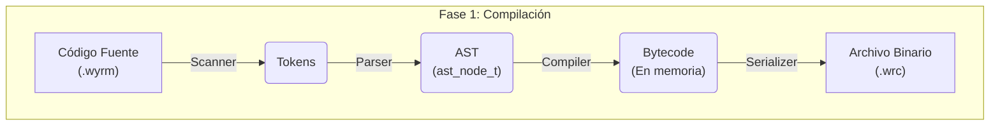
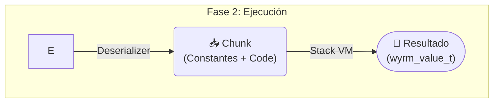
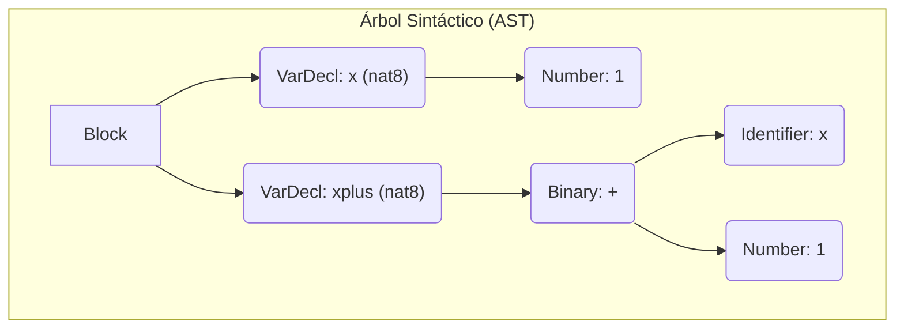

Antes de implementar el intérprete está bueno tener claro que y como queremos que funcione en Wyrm


# Aproximación por bytecode

El flujo de un compilador en su base es ajuarar un código escrito por un humano (o una IA) y convertirlo en instrucciones que pueda entender la computadora; sin embargo, sin tener que escribir código ensamblador directamente podemos compilar los Bycode en un línea de instrucciones para que una máquina virtual (VM) las ejecute. Si logramos mapear todo un programa a instrucciones simples no tenemos por qué ejecutar el AST directamente con recursividad y muchas cargas a memoria. Si no que vamos al hueso de la ejecución, en un flujo de intérpretes todo ocurre depende, el escaneo, él parseó y la ejecución. En cambio, si generamos un archivo Bycode un".wrc" solo pasa por el scanner y el parser una vez, luego la VM lo puede ejecutar.



## ¿Como ganamos tanta velocidad? 
Aprovechando una estructura conocida como "pila" o stack, su principal característica es que solo se puede accerde al "tope" de la pila, si tuviéramos una pila de intrusiones solo se ejecuta una a la vez. Además de ser una estructura muy compatible con árboles, puesto que representa un árbol recorrido "pots order"




Supongamos que tenemos un codigo simple en **Wyrm**

```c
nat8 x = 1;
nat8 xplus = x + 1;
```

Para el intérprete el árbol de ejecución se construye así y se evalúa de abajo hacia arriba, nótese que para cada paso hacemos una llamada para reservar memoria



En cambio, si lo ejecutamos con una VM, el stack se carga a memoria antes, y tenemos las direcciones de memorias ya en la memoria RAM por lo que el acceso es casi automático, además de que no hay que llamar para reservar memoria. Hay que tener en cuenta que dentro de nuestra "ejecucion" tenemos variables locales, estas variables no son más que cajas para guardar valores. Si se declara una variable lo que se hace es reservar un lugar en el stack para esa variable y cuano se invoca `get_local(n)` se recupera el valor de esa "caja" y se empuja una copia al final del stack

La lista de operaciones se veria algo asi:

```C
push(1); // empuja 1 al estack de valores  el stack queda como [1]
get_local(0) // enpuja el valor de la variable local x (indice 0) al stack queda como [1 1]
push(1) // estack como [1,1]
sum() //esto consume los ultimos dos valores de del stack y los suma, el stack pasa de  [1,1,1] a [1,2]
// se elijio un diseño de pila unifcada, eso quiere decir que en le mismo estack de valores conviven las variables locales.
// el stack quedo como [1.2] pero podria leerse como [x,xplus], si alguien quiere acceder a x puede hacerlo con un get en 0 
```

Fijémonos que todas las operaciones fueron `O(1)` y no tuvimos que llamar al sistema para reservar memoria, solo manipular idnices de arreglos, algo muy simple de hacer. Obviamente, nos salteamos como se resuelven los tipos, pero escapa un poco a la explicación, pero sirve para ejemplificar.


## Pila unificada VS Pila separada

Una forma de trabajar con bycode es tener pilas separadas, una exclusiva para valores y otra para las variables. Al hacerlo no "Ensuciamos" el stack de valores que van a durar mucho tiempo y solo tenemos los valores con also que operamo, ejemplo:

```C
push(1); // empuja 1 al estack de valores  el stack queda como [1]
set_local(0) // guardamos en el indice 0 de las variables locales el ultimo valor del stack, el mismo queda como []
get_local(0) // enpuja el valor de la variable local x (indice 0) al stack queda como [1]
push(1) // estack como [1,1]
sum() //esto consume los ultimos dos valores de del stack y los suma, el stack pasa de  [1,1] a [2]
set_local(1) // ahora guardamos el 2, el stack quda vacio y nuestro pool de variables locales no deja con [1,2]
```

No parece ni muy distinto, y en realidad no lo es, pero tiene un problema de que aumenta las llamadas para reservar memoria. Sin entrar en detalle de como se reuselven las funciones, recordemos que las variables locales son uncias del "scope" actual y esto significaria que cada vez que detectamos un nuevo scope debemos almacenar espacio para esas variables. O debemos saber cuantas variables locales necesitamos, aunque no es una mala aproximación sería reservar espacio o muchas veces o una vez pero de gran cantidad, cuando cada porcion se va a usar pocas veces. Con el estilo de pila unificada las variables quedan "guardadas" mientas se usen, ocupando lugar en el stack principal solo cunado se están utilizado.

## Jerarquías y variables globales

//TODO cuando lleguemos a esos tests resolvemos

## Funciones de ejecución 

//TODO cuando lleguemos a esos tests resolvemos

## Tamaños, Límites y Gestión de Memoria

No todo es perfecto cuando hablamos de Bytcode, como cada operacion se codifica en bytes del estilo `0x01` es una operacion, y cada operacion puede tener argumentos `0x01 0x00` (operacion de indice 1 con argumeto 0), estamos obligados a establecer un límite logico en la cantidad de variables que podemos tener cargadas. Ejemplo si usamos 1 byte para codificar las operaciones, nuestro máximo de operaciones seria de 256, que puede parecer poco pero en realidad Java y Python usan índices de un Byte para sus operaciones. Como nuestro sitema de **Wyrm** esta fuertemente basado en Java, se espera que podamos resolverlo con menos de 256 operaciones todas se escribirán el primer byte.

Tenemos resuelto el espacio de operaciones en un Byte, pero no resolvimos cuantos bytes usaremos de argumento, podriamos poner tambein 256 pero hay que tener en cuenta que dentro de un stack tambien guardamos variables locales, limitar a 256 las variables locales se torna muy limitante hoy en dia. No es bueno abusar de la capacidad moderna del hardware pero ampliando el espacio de argumento a 2 bytes, aplicamos la `65,535` la capacidad maxima. En la practica nadie deberia tener una función con `65,535` argumentos o `65,535` variables locale, es un limit que no deberías encontrar en ninguna implementación, por eso es perfecta para **Wyrm**.

Y para no tener problemas sobre tamaño de los archivos podemos usar una stack dinamico, siempre pensado en no cargar demasiados KiloBytes en la memoria RAM, normalmente los archivos sond e 1 MB como maximo, 1 MB es una locura para un programa, son `1024` KB, suponiedo el tamñano maximo de un `wyrm_value`es:

```C
struct WyrmValue {
    WyrmValueType type; // 4 bytes o 32 bits
    union { // union toma el maximo posible 64 bits u 8 bytes
        uint8_t nat8_val;
        uint16_t nat16_val;
        uint32_t nat32_val;
        uint64_t nat64_val;

        int8_t int8_val;
        int16_t int16_val;
        int32_t int32_val;
        int64_t int64_val;

        _Float32 float32_val;
        _Float64 float64_val;
        bool bool_val;
        wyrm_function_t wyrm_function_val;
    } value; 
    // el total es 12 bytes pero recordemos que se alina a 8 quedando en 16 Bytes finales
};
```
 `16` Bytes por valor en un MB tenemos `(1024^2/16)` unos `65,536` valores al mismo tiempo en el stack. Para no estar ocupando siempre 1 MB de la memoria, inicialmente solo se alojaban `1024*16` bytes y dinámicamente se sumará espacio.

### Resumen:

Dimensions en el Archivo Binario (`.wrc`) y Bytecode:
1 byte de operación y 2 de argumento 3 bytes totales, usaremos `uint8_t uint16_t` exactamente 3 Bytes, los archivos `.wrc` son tiras de parseadas de a 3.

Variables Globales (`uint16_t global_count`): 
Hasta `65,535` variables globales. El total exacto se registra en el **Header** del `.wrc` y la VM reserva el espacio justo al iniciar mediante `calloc(global_count, sizeof(wyrm_value_t))`.

Pool de Constantes (`uint16_t const_count`):
Hasta `65,536` literales únicos por módulo compilado.

Variables Locales por Función:
Hasta `65,536` variables locales simultáneas por ámbito de ejecución.

Saltos de Control de Flujo (`OP_JUMP`, `OP_LOOP`):
Desplazamientos relativos de 16 bits (`uint16_t`), permitiendo saltar hasta `65,536` Bytes de instrucciones hacia adelante o hacia atrás.

**Arquitectura del Stack en Tiempo de Ejecución (VM):**

Capacidad Inicial del Value Stack:
`1,024` elementos (`16 KB` iniciales reservados con `malloc(1024 * sizeof(wyrm_value_t))`).

Indexación Segura (`size_t sp`):
El tope de la pila se controla mediante un índice numérico (`sp`) en lugar de un puntero directo. Y se verifica si necesita más espacio

Crecimiento y Límite (**ERR_STACK_OVERFLOW**):
Si `sp` alcanza la capacidad actual, el stack duplica su tamaño (`capacity *= 2`) hasta un tope máximo de seguridad de `65,536` elementos (`1 MB`), tras lo cual la VM aborta de forma segura con **ERR_STACK_OVERFLOW**.

# Reflexión extra

Investigando sobre el team salta a la vista que un Bytecode + VM es una representación bastate fiel a una máquina de Turing determinista clásica. Si pensamos la cinta como la lista de operaciones, lo que hacemos es leer, escribir y saltar con base en la lista de operaciones, siempre una a la vez. La diferencia principal sería que no escribimos sobre la misma cinta que leemos, pero el comportamiento primario es bastante similar. Es increíble como acercarnos a la forma "primaria" nos ayuda mucho a la hora de optimizar cada proceso. 

